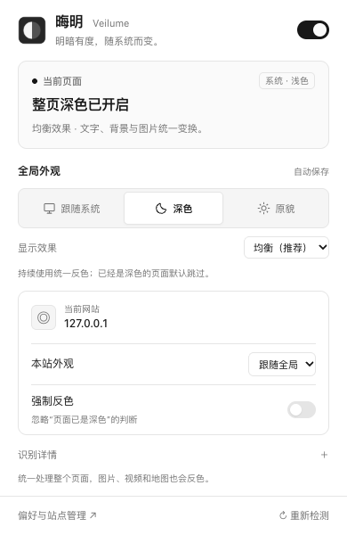

# 晦明 · Veilume

[](https://github.com/Hxgh/veilume/actions/workflows/ci.yml)
[](LICENSE)

**明暗有度，随系统而变。** 本地运行、零运行时依赖的 Chrome MV3 整页反色扩展。

> “晦明变化者，山间之朝暮也。”——欧阳修《醉翁亭记》

“晦明”是暗与明的往复；**Veilume** 融合 veil 与 lumen，寓意为光线覆一层柔和的帷幕。[命名说明](docs/NAMING.md)

Veilume is a local-first Chrome extension that follows your system appearance. One compositing filter transforms the whole page; two presets keep the controls simple. Images and video also change color. No telemetry, accounts, remote code, or runtime dependencies.

<picture>
  <source media="(prefers-color-scheme: dark)" srcset="docs/assets/popup-dark.png">
  
</picture>

## 安装 / Install

1. 从 [Releases](https://github.com/Hxgh/veilume/releases/latest) 下载 `veilume-版本号-chrome.zip` 并解压。
2. Chrome 打开 `chrome://extensions/`，开启“开发者模式”。
3. 点击“加载已解压的扩展程序”，选择包含 `manifest.json` 的 **veilume** 文件夹。
4. 固定到工具栏。对安装前打开的网页，点击扩展图标接入或刷新页面。

No build is needed for release ZIPs: unzip, open `chrome://extensions/`, enable Developer mode, choose **Load unpacked**, and select the `veilume` directory.

普通使用不需要 Node.js。要求 Chrome 120+；实际验证版本见[测试报告](docs/TESTING.md)。尚未发布 Chrome 商店，没有扩展代码自动更新；请保留加载目录。

## 两种效果，三种外观

“全局外观”决定**什么时候处理**；“显示效果”决定**怎样显示**，两者独立。

| 控件 | 行为 |
| --- | --- |
| 跟随系统（默认） | 系统深色时处理，系统浅色时恢复原貌 |
| 深色 | 始终以深色为目标，默认仍保护已有深色的页面 |
| 原貌 | 撤销本插件，不改变网站自己的主题设置 |
| 均衡（推荐） | 明暗层次清晰，默认显示效果 |
| 低亮 | 同一算法，降低文字和高光亮度 |
| 恢复推荐 | 一键回到均衡，不改变系统跟随方式 |
| 本站外观／强制反色 | 按主机名保存例外，或纠正原生识别误判 |
| 总开关 | 全局暂停，保留全部偏好 |

预设切换即时生效并同步标签页；刷新后保留。不增加网站专用修补规则或图片豁免。

## 算法与代价

```css
/* 均衡 balanced */
filter: invert(1) hue-rotate(180deg) contrast(0.88) brightness(0.95);
/* 低亮 dim */
filter: invert(1) hue-rotate(180deg) contrast(0.88) brightness(0.82);
```

一套变换覆盖文字、背景、渐变、图片、Canvas、视频和 iframe 的合成画面，不逐个改写元素颜色。均衡下纯白约变为 `#0f0f0f`、纯黑约为 `#e4e4e4`；低亮约为 `#0d0d0d` 和 `#c5c5c5`。

**照片、地图、图表和视频也会变色，原本深色的局部可能变亮。** 修图、审稿、核对颜色或看视频时，请将本站恢复原貌。全局反色不是网站原生主题的完美替代。

## 兼容与隐私

- 普通 HTTP / HTTPS HTML 网页；动态 DOM、CSSOM、开放与封闭 Shadow DOM；iframe 只随顶层变换一次。
- 原生对话框、Popover 和顶层文档全屏元素使用同一预设；打印不反色。
- 20 点背景取样保护已有深色；图片、透明命中层等不确定像素不当作深色证据。识别可能误判，可手动纠正。
- 不支持 Chrome 内部页、扩展商店、内置 PDF、本地文件、独立图片／SVG 文档。嵌入页独立全屏、原生菜单、复杂根滤镜等可能有差异；首次加载可能短暂出现原色。
- 无账号、广告、统计、网络读取、云同步或远程代码。只在 `chrome.storage.local` 保存偏好及手动设置过例外的主机名，不保存正文、密码或访问历史。
- 网站权限用于自动识别与显示处理；`storage` 保存设置；`activeTab` / `scripting` 用于弹窗接入安装前的页面。可在 Chrome 扩展详情中缩小授权范围。

## 更新与迁移

更新时，将新文件替换到原加载目录，在扩展管理页重新加载，再刷新旧页面。目录不变即可保持扩展 ID 与设置。

前身为“随色 · System Shade”。为保留同一扩展 ID 下的旧偏好，内部存储键与兼容消息名称暂时保留；1.x / 2.0 设置升级后默认使用均衡。**不同加载目录会产生新 ID，设置不会自动跨 ID 迁移。不要同时启用两份扩展。**

## 开发与测试

```sh
git clone https://github.com/Hxgh/veilume.git
cd veilume
npm ci
npm run build
npm run check
npm run test:e2e
npm run package
```

加载构建后的 `dist/`，不是尚未生成图标的 `extension/`。源码 ZIP 不含依赖和构建产物。端到端测试默认使用本机 Chrome 的一次性隔离资料目录，不读取日常配置。无 Chrome 时：

```sh
npx playwright install --with-deps chromium
SHADE_BROWSER=chromium npm run test:e2e
```

CI 使用 GitHub Ubuntu 镜像预装的 Chrome 运行固定本地测试，不重复下载浏览器，也不依赖外部网站。`npm run test:smoke` 为可选公网页面抽查；`VEILUME_PRESET=dim npm run test:smoke` 测低亮。结果与真实网页截图默认忽略，不提交到 Git。

`npm run demo` 启动本机演示：`http://127.0.0.1:4173/split-login`、`/lab`、`/native`。Ctrl+C 结束。

## 维护

提交与 PR 自动执行构建、单测、像素／交互测试和打包。Dependabot 每月提出依赖更新 PR，**不自动合并**。问题请附公开 URL、版本、模式和脱敏截图。

- [设计与开源调研](docs/DESIGN.md)
- [测试报告](docs/TESTING.md)
- [贡献与发布流程](CONTRIBUTING.md)
- [版本记录](CHANGELOG.md)
- [开源许可说明](THIRD_PARTY_NOTICES.md)

MIT License © 2026 Hxgh.
